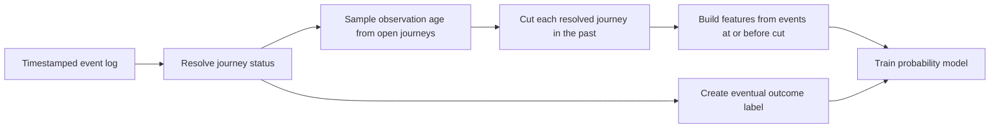

# Customer Journey Outcome Modeling

This project predicts whether a partially observed customer journey will eventually reach shipment and explores behavioral segments in event sequences. The central modeling challenge is temporal leakage: a model scored on an open journey must use only events that would have been visible at prediction time.

This repository is a sanitized, portfolio-ready reconstruction of a capstone project. The original event logs, customer and account identifiers, course files, notebooks, and submission files are intentionally excluded. Every runnable example uses synthetic events.

## What the Project Demonstrates

- Event-level logs transformed into one row per journey
- Outcome labeling with a configurable inactivity window
- Pseudo-cut snapshots that mimic open journeys without exposing future events
- Funnel, recency, engagement, and last-event feature engineering
- Random Forest and optional XGBoost probability models
- Optional Sentence-BERT, PCA, and K-means sequence clustering
- Explicit separation between full-history labels and snapshot-time features

## Leakage-Safe Design



The eventual outcome is derived from the complete resolved journey, but all predictors are calculated from the earlier snapshot. The tests include a direct check that a post-cut shipment event cannot enter the feature set.

## Reported Project Results

The original capstone evaluation reported the following prediction scores, where lower was better. The underlying scoring data is not distributed here.

| Model | Reported score |
|---|---:|
| XGBoost | 0.03794 |
| Random Forest | 0.03825 |
| Funnel-stage grouped XGBoost | 0.03879 |

The unified XGBoost model performed best. Splitting the training set by funnel stage added complexity but reduced the data available to each subgroup; a single model could already learn stage interactions from the engineered features.

For the unsupervised analysis, normalized Sentence-BERT embeddings were reduced to 50 principal components before K-means. Among `k = 3, 4, 5`, the original analysis selected `k = 4` based on the best silhouette score and Davies-Bouldin index:

| Clusters | Silhouette | Davies-Bouldin |
|---:|---:|---:|
| 3 | 0.276892 | 1.497141 |
| 4 | 0.298584 | 1.300421 |
| 5 | 0.240423 | 1.529068 |

## Repository Structure

```text
.
├── data/README.md
├── examples/run_synthetic_demo.py
├── src/journey_modeling.py
├── src/journey_clustering.py
├── tests/test_journey_modeling.py
├── requirements.txt
├── requirements-clustering.txt
└── requirements-xgboost.txt
```

## Run the Synthetic Demo

```bash
python -m pip install -r requirements.txt
python examples/run_synthetic_demo.py
python -m unittest discover -s tests -v
```

The core demo trains a Random Forest because it has a lightweight dependency footprint. Install `requirements-xgboost.txt` to use the optional boosting helper. The clustering module imports Sentence-BERT only when embeddings are requested; install `requirements-clustering.txt` for that workflow.

## Data Contract

Authorized input data must contain exactly the behavioral fields needed for modeling:

- `journey_id`: pseudonymous journey key
- `event_name`: normalized event token
- `event_timestamp`: event time

Direct identifiers should be removed before data reaches this pipeline. See `data/README.md` for the full handling policy.

## Privacy and Limitations

- No original customer, account, order, or event-level records are included.
- No real identifiers, timestamps, predictions, or representative journey strings are included.
- No original notebooks are included because cell outputs may retain sensitive rows or paths.
- The reported scores are historical project results, not reproduced from the synthetic demo.
- Pseudonymization and model-parameter sharing are not formal privacy guarantees.
- Production use would require access controls, retention limits, monitoring, and a documented lawful basis for processing.

